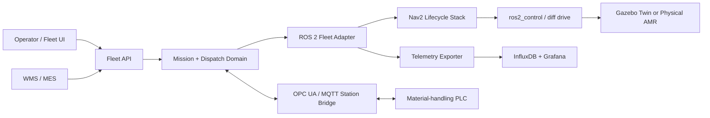

# System Architecture

## Context

## Architectural boundaries

1. **Domain core** owns missions, dispatch eligibility, station leases, and invariants. It contains no ROS imports.
2. **ROS adapters** translate actions, services, topics, and lifecycle transitions into domain commands and events.
3. **Robot autonomy** owns localization, planning, control, and bounded recovery through Nav2.
4. **Hardware adapters** implement wheel, encoder, E-stop, bumper, and battery interfaces through `ros2_control` and diagnostic topics.
5. **OT bridge** maps semantic station handshake states to OPC UA nodes or MQTT topics. Raw PLC tags do not leak into the domain model.
6. **Observability** consumes immutable events and current-state snapshots. It does not command the robot.

## Deployment units

| Unit | Responsibility | Failure containment |
|---|---|---|
| Fleet service | Mission intake, allocation, station coordination | Reject new dispatch; active robots finish or enter hold policy |
| Robot supervisor | Lifecycle and health aggregation | Deactivate navigation on required-node loss |
| Nav2 stack | Localization, planning, control, recovery | Lifecycle manager performs ordered shutdown |
| OT bridge | Station handshake translation | Lease expires; docking/transfer is inhibited |
| Telemetry exporter | Metrics and event export | Buffered loss; no motion impact |

## Data ownership

- Mission IDs are globally unique and immutable.
- The fleet service is authoritative for mission assignment and station leases.
- Each robot is authoritative for its pose, health, and execution feedback.
- The PLC is authoritative for station readiness and transfer completion.
- Wall-clock timestamps support correlation; monotonic clocks enforce local timeouts.

## Degraded modes

- **Telemetry stale:** robot excluded from new dispatch.
- **Fleet service unavailable:** robot completes its current safe segment or holds; it accepts no new mission.
- **Station bridge unavailable:** no station access grant; robot waits at the approach waypoint.
- **Localization invalid:** navigation is canceled and the robot stops under the control-layer timeout.
- **Primary range sensor unavailable:** return-home is permitted only when the configured alternate perception path is healthy and the risk analysis allows it.

