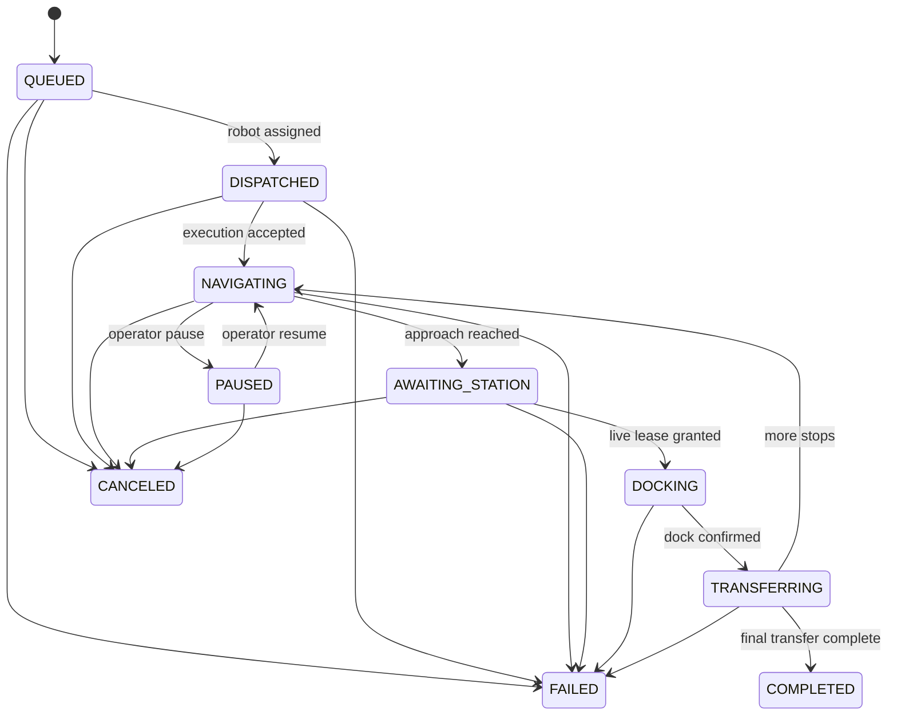

# Mission and Station Interface Specification

Document ID: AMR-ICD-001  
Revision: A

## Mission lifecycle

Terminal states are `COMPLETED`, `CANCELED`, and `FAILED`. No transition leaves a terminal state.

## Station handshake

| Step | AMR/fleet output | Station/PLC response | Timeout action |
|---|---|---|---|
| 1 | Entry request with robot, mission, station | Request accepted or rejected | Remain at approach waypoint |
| 2 | Wait | Exclusive access grant with lease ID and expiry | Retry under bounded policy |
| 3 | Docking started | Station maintains grant | Stop if grant becomes invalid |
| 4 | Docked confirmation | Transfer command/ready | Hold position |
| 5 | Transfer acknowledgement | Transfer complete | Fail or operator intervention |
| 6 | Release lease | Station clears occupancy | Reconcile stale lease by expiry |

The lease ID is mandatory on docking and transfer events. This prevents a delayed message from an earlier request being accepted for a later mission.

## Idempotency

- Mission submission uses a client-provided mission ID. Repeated submission of the same ID and payload returns the existing mission.
- Reusing an existing ID with a different payload is rejected.
- Lease release is idempotent.
- Completion events for the current phase are idempotent at the adapter boundary and are recorded once in the domain event stream.

## ROS interfaces

- `ExecuteMission.action`: long-running mission request and feedback.
- `RequestStationAccess.srv`: station lease request/response.
- `MissionState.msg`: current mission projection.
- `RobotState.msg`: dispatch and operational telemetry projection.

## Error categories

| Code family | Meaning | Retry policy |
|---|---|---|
| `MISSION_*` | Invalid lifecycle command or duplicate mismatch | Do not retry unchanged request |
| `ROBOT_*` | Robot unavailable, stale, degraded, or low battery | Re-evaluate fleet |
| `STATION_*` | Busy, unknown, stale lease, or bridge unavailable | Bounded retry at approach |
| `NAV_*` | Planning, control, localization, or recovery failure | Nav2 bounded recovery then fail/hold |

