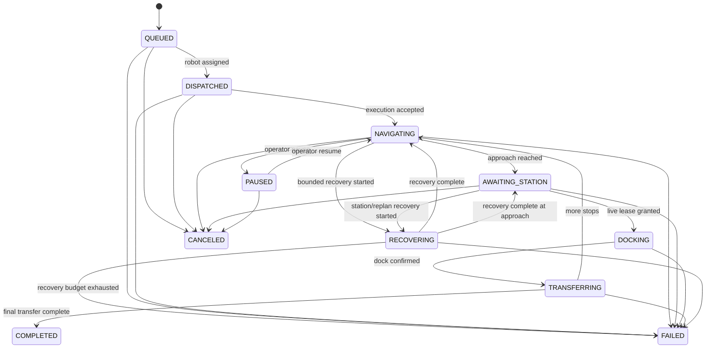

# Mission and Station Interface Specification

Document ID: AMR-ICD-001  
Revision: A

## Mission lifecycle

Terminal states are `COMPLETED`, `CANCELED`, and `FAILED`. No transition leaves a terminal state.

## Station handshake

| Step | AMR/fleet output | Station/PLC response | Timeout action |
|---|---|---|---|
| 1 | Entry request with robot, mission, station | Request accepted or rejected | Remain at approach waypoint |
| 2 | Wait | Exclusive access grant with lease ID and expiry | Retry under bounded policy |
| 3 | Docking started | Station maintains grant | Stop if grant becomes invalid |
| 4 | Docked confirmation | Transfer command/ready | Hold position |
| 5 | Transfer acknowledgement | Transfer complete | Fail or operator intervention |
| 6 | Release lease | Station clears occupancy | Reconcile stale lease by expiry |

The lease ID is mandatory on docking and transfer events. This prevents a delayed message from an earlier request being accepted for a later mission.

## Idempotency

- Mission submission uses a client-provided mission ID. Repeated submission of the same ID and payload returns the existing mission.
- Reusing an existing ID with a different payload is rejected.
- Lease release is idempotent.
- Completion events for the current phase are idempotent at the adapter boundary and are recorded once in the domain event stream.

## ROS interfaces

- `ExecuteMission.action`: long-running mission request and feedback.
- `RequestStationAccess.srv`: station lease request/response.
- `MissionState.msg`: current mission projection.
- `RobotState.msg`: dispatch and operational telemetry projection.

## ROS fleet adapter topics and endpoints

The `amr_fleet_adapter` package exposes the domain core through ROS 2:

| Type | Name | Purpose |
|---|---|---|
| Action | `fleet/execute_mission` | Translate a station/waypoint mission goal to a domain mission and dispatch/start it |
| Service | `fleet/request_station_access` | Request a correlated station lease for the active mission |
| Subscription | `fleet/robot_updates` | Ingest robot pose, battery, health and availability snapshots |
| Publisher | `fleet/robot_states` | Publish fleet robot telemetry projection and active mission/fault codes |
| Publisher | `fleet/mission_states` | Publish mission state, current station, lease and revision projection |

## JSON/HTTP fleet API

The HTTP adapter is intentionally thin; it translates JSON into the same domain
commands used by ROS adapters and returns protocol-safe errors instead of
leaking Python exceptions.

Mission stops may either include an explicit `approach_pose` or reference a
configured station/waypoint pair from the named waypoint catalog. This allows WMS
or operator clients to submit stable business-level targets without hard-coding
map coordinates in every request.

| Method | Path | Purpose |
|---|---|---|
| `POST` | `/robots/{robot_id}/telemetry` | Update pose, health, battery, availability and telemetry timestamp |
| `POST` | `/missions` | Submit an idempotent mission with one or more station stops |
| `POST` | `/dispatch` | Batch-dispatch queued missions across the eligible idle fleet |
| `GET` | `/missions/{mission_id}` | Read mission state, event revision and current stop |
| `POST` | `/missions/{mission_id}/dispatch` | Assign the nearest eligible robot |
| `POST` | `/missions/{mission_id}/start` | Mark robot execution accepted |
| `POST` | `/missions/{mission_id}/arrive` | Mark current station approach reached |
| `POST` | `/missions/{mission_id}/station-access` | Request an exclusive station lease |
| `POST` | `/missions/{mission_id}/dock/start` | Start docking with a correlated lease ID |
| `POST` | `/missions/{mission_id}/dock/confirm` | Confirm docked state with the same lease ID |
| `POST` | `/missions/{mission_id}/transfer/complete` | Complete transfer and release the lease |
| `POST` | `/missions/{mission_id}/pause` | Pause a navigating or station-waiting mission |
| `POST` | `/missions/{mission_id}/resume` | Resume to the pre-pause phase |
| `POST` | `/missions/{mission_id}/cancel` | Cancel and release robot/station resources |
| `POST` | `/missions/{mission_id}/recovery/start` | Begin a bounded recovery attempt |
| `POST` | `/missions/{mission_id}/recovery/complete` | Return from recovery to the resumable phase |
| `GET` | `/telemetry` | Read fleet projection and immutable audit events |

## Error categories

| Code family | Meaning | Retry policy |
|---|---|---|
| `MISSION_*` | Invalid lifecycle command or duplicate mismatch | Do not retry unchanged request |
| `ROBOT_*` | Robot unavailable, stale, degraded, or low battery | Re-evaluate fleet |
| `STATION_*` | Busy, unknown, stale lease, or bridge unavailable | Bounded retry at approach |
| `NAV_*` | Planning, control, localization, or recovery failure | Nav2 bounded recovery then fail/hold |

## Observability projection

Fleet telemetry is projected as a read-only snapshot containing robot freshness,
mission state/revision, active station leases, evaluated alarms and API audit
events. The current exporter renders this projection as InfluxDB line protocol
for later Grafana dashboards. Observability code never calls domain commands.
