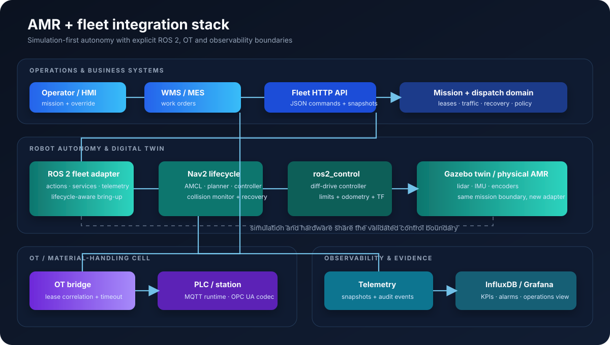
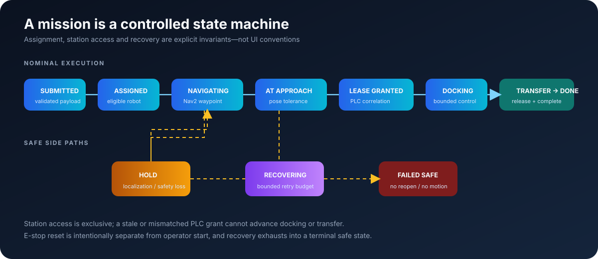
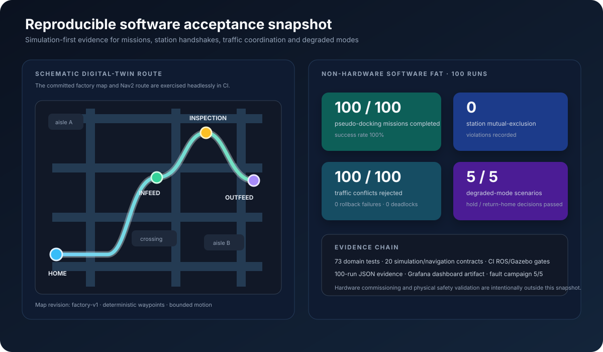

# AMR and Fleet Integration Stack

## Portfolio-ready project brief

This project is a simulation-first industrial AMR platform that connects a
differential-drive robot, a fleet domain, Nav2 autonomy, station handshakes and
operations telemetry. It demonstrates the engineering of an intelligent system
that can be tested, supervised and integrated—not only a robot that can move.

**Release status:** software, simulation and portfolio evidence are ready for
publication. Physical AMR commissioning remains intentionally open and is not
represented as complete.

## What a reviewer can verify

| Capability | Implementation and evidence |
| --- | --- |
| Mapping and map reuse | SLAM Toolbox mapping launch, versioned factory map and AMCL/Nav2 localization |
| Mission execution | Named waypoints, mission lifecycle, ROS 2 action adapter and JSON/HTTP API |
| Pseudo-docking | Bounded approach controller gated by pose tolerance, station lease and PLC correlation |
| Fleet behavior | Deterministic dispatch, batch allocation, charging policy and atomic traffic reservations |
| Recovery and degraded mode | Bounded recovery, stale telemetry rejection, safe hold and return-home supervision |
| OT/IT integration | MQTT station runtime, PLC simulators, OPC UA codec boundary, InfluxDB and Grafana |
| Simulation | Gazebo Harmonic digital twin, ros2_control differential drive and namespaced multi-AMR launch |
| Verification | 73 domain tests, 20 simulation/navigation contracts, CI ROS/Gazebo gates and 100-run FAT |

## Measured software acceptance snapshot

The committed artifact
[`software-acceptance-20260718T101127Z.json`](../verification/evidence/software-acceptance-20260718T101127Z.json)
records a 100-run non-hardware campaign:

- 100/100 MQTT pseudo-docking missions completed.
- 0 station mutual-exclusion violations; 100/100 contenders were rejected.
- 100/100 conflicting traffic routes were rejected with 0 rollback failures and 0 deadlocks.
- 5/5 degraded-mode scenarios passed.
- Local API acknowledgement p95 was 0.016 ms on the acceptance host.

The ROS/Gazebo runtime gates are independently exercised in the
[passing GitHub Actions run 28881834692](https://github.com/chad416/amr-fleet-integration-stack/actions/runs/28881834692),
including package build/test, Gazebo motion, SLAM mapping, AMCL/Nav2 waypoint
acceptance and multi-AMR motion acceptance.

## Portfolio card copy

> **AMR and Fleet Integration Stack** — Built a simulation-first autonomous
> mobile robot platform with ROS 2 Jazzy, Nav2, SLAM Toolbox, Gazebo Harmonic,
> ros2_control, a deterministic fleet domain, MQTT/OPC UA station integration,
> and InfluxDB/Grafana telemetry. The system executes waypoint missions,
> coordinates multiple robots, gates pseudo-docking on correlated PLC leases,
> and enters bounded degraded modes when localization, perception or network
> health changes. The software FAT completed 100/100 station missions with zero
> station mutual-exclusion violations. Physical commissioning is the next
> deliberately separated gate.

Suggested technology tags: `ROS 2` · `Nav2` · `SLAM Toolbox` · `Gazebo` ·
`ros2_control` · `Python` · `MQTT` · `OPC UA` · `InfluxDB` · `Grafana` · `CI/CD`

## Review path

1. Start with the [root README](../../README.md) for the runnable project map.
2. Inspect the [system architecture](assets/system-architecture.svg) and
   [mission lifecycle](assets/mission-lifecycle.svg) visuals.
3. Run the host-side domain verification and software FAT using the commands in
   the root README.
4. Follow the [simulation commissioning checklist](../commissioning/simulation-checklist.md)
   in Ubuntu 24.04 with ROS 2 Jazzy for the digital-twin runtime evidence.
5. Inspect the [verification plan](../verification/verification-plan.md),
   [risk analysis](../safety/mobile-operation-risk-analysis.md) and
   [interface specification](../interfaces/mission-and-station-interface.md)
   for engineering depth.

## Demo recording plan

The [demo runbook](demo-runbook.md) defines a short simulation-first recording:
show the factory world and map, dispatch a named waypoint mission, show the
station lease/PLC exchange, demonstrate a bounded fault response, then open the
Grafana dashboard. This is a reproducible software demonstration; it must not
be edited to imply physical hardware operation.

## Explicit boundary

This repository does not claim a certified safety function. The remaining
physical gate covers approved hardware selection, motor/encoder/sensor
integration, independent E-stop and bumper validation, calibration, stopping
distance tests, controlled-area SAT, physical video and simulation-versus-real
comparison. The software/simulation package is complete without claiming that
those physical activities have occurred.
